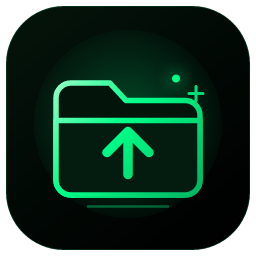
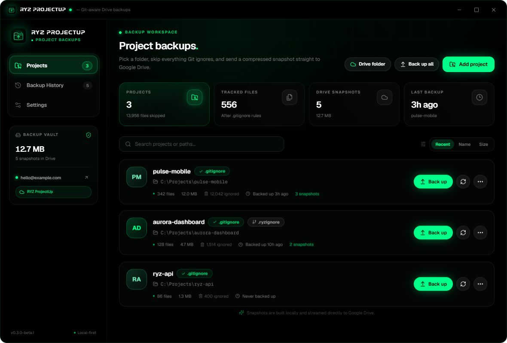
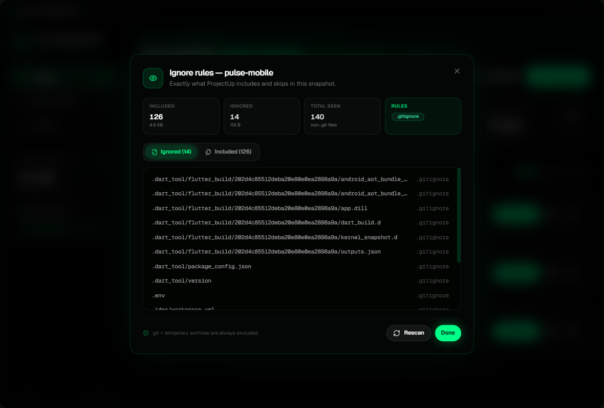
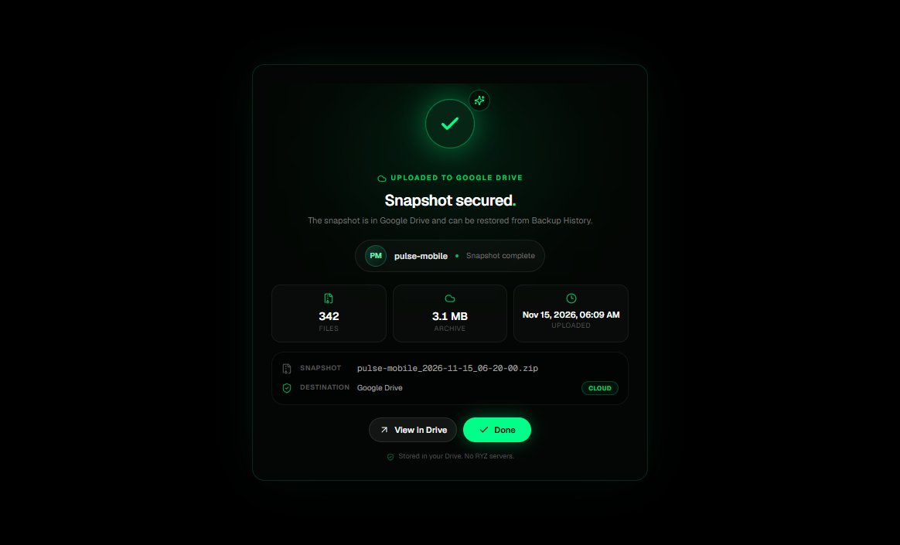

<p align="center">
  
</p>

<h1 align="center">RYZ ProjectUp</h1>

<p align="center">
  <strong>Git-aware project backups, straight to your Google Drive.</strong><br />
  Select a folder. ProjectUp reads its <code>.gitignore</code>, skips the noise, builds a compressed snapshot, and uploads it directly to your own Drive.
</p>

<p align="center">
  <a href="https://github.com/riyazalsodie/RYZ-ProjectUp/releases"></a>
  <a href="https://github.com/riyazalsodie/RYZ-ProjectUp/actions/workflows/ci.yml"></a>
  
  
  
  
  
  
</p>

<p align="center">
  <a href="#download">Download</a> ·
  <a href="#quick-start">Quick start</a> ·
  <a href="#google-drive-setup">Google Drive setup</a> ·
  <a href="#development">Development</a> ·
  <a href="#code-signing-policy">Code signing policy</a> ·
  <a href="#beta-notes">Beta notes</a>
</p>



> Preview with sample data. The OLED black + green theme and rounded, frameless window are the real app UI.

---

## What is RYZ ProjectUp?

RYZ ProjectUp is a **local-first desktop backup vault** for code and project folders. It is built with **Tauri 2, Rust, React 18 and TypeScript**, and it talks **directly to Google Drive** using your own Google OAuth client — no RYZ servers, no telemetry, no middleman.

It is designed for developers who want a one-click, git-aware snapshot of a project without committing build artifacts, dependencies or secrets.

```text
Select a folder  →  Read ignore rules  →  Build zip locally  →  Upload to Drive  →  Keep or restore any version
```

---

## Features

| | |
| --- | --- |
| **Git-aware scanning** | Reads the full `.gitignore` spec — nested files, globs, directory rules and negations — using the same Rust `ignore` engine that powers ripgrep. |
| **Ignore Inspector** | See exactly what will go into a snapshot, what will be skipped, why it was skipped, and how much space is saved. |
| **Direct Google Drive uploads** | Streams a compressed snapshot to your own Drive folder. No RYZ cloud in the middle. |
| **OAuth 2.0 + PKCE** | Connects through a loopback redirect and your own Desktop OAuth client. Tokens never pass through a third party. |
| **Snapshot retention** | Keep the last N backups per project — older Drive files are cleaned up automatically. |
| **Restore anywhere** | Download any snapshot and extract it into a fresh folder. Zip-slip protected. |
| **Backup history** | Search, open in Drive, restore or delete every snapshot from one place. |
| **Bulk backups** | Back up every available project in one run, with a live “x / y” indicator and a stop control. |
| **Scheduled backups** | Set one interval from 6 hours to a week. Each project is checked against its own newest snapshot, so a recent backup in one project never blocks another. |
| **System tray mode** | Minimize or close to the tray, reopen from the tray icon, or start **Back up all** from its menu. ProjectUp keeps a single instance and restores the existing window when launched again. |
| **Launch at startup** | Start quietly in the tray at login so due snapshots can run without opening the dashboard. |
| **Global backup hotkey** | Press `Ctrl+Shift+B` from any app to bring ProjectUp forward and run **Back up all**. It can be disabled in Settings. |
| **Drive vault index** | Projects, original folders and snapshot history are saved to a private `ryz-projectup-vault.json` in your Drive folder. Connect from a new PC and the whole vault comes back. |
| **Encrypted credentials** | OAuth secrets and refresh tokens live in a `secrets.bin` blob encrypted with Windows DPAPI — never in plain settings files. |
| **Relink on a new PC** | Restored projects whose folders moved show a **Folder missing** warning and a one-click **Relink folder** action — history is kept. |
| **Extra ignore rules** | Add global patterns on top of each project's rules, or drop a `.ryzignore` file inside a project. |
| **In-app setup guide** | A complete Google Cloud walkthrough with direct links, test-user steps and OAuth troubleshooting. |
| **OLED UI** | Pitch-black surfaces, `#00FF88` accents, rounded cards and dialogs, custom frameless title bar and subtle motion. |

### A closer look

| Backup history | Ignore Inspector |
| --- | --- |
|  |  |

### Snapshot completion

<p align="center">
  
</p>

A successful upload gets a dedicated completion view with an animated check, a confetti burst, quick file/size/date stats, and direct Drive access.

### Google Drive setup, inside the app

<p align="center">
  
</p>

The built-in guide covers creating the Google Cloud project, enabling the Drive API, the consent screen, test users, the `drive.file` scope, creating a **Desktop app** OAuth client, and fixing common OAuth errors.

### Automation and background mode

Open **Settings → Automation & background** to configure:

- **Scheduled backups** — pick a 6-hour, 12-hour, daily, 3-day or weekly interval. Each project is evaluated independently against its own latest snapshot. The schedule only runs while ProjectUp is open; the background pass checks every five minutes.
- **Launch at startup** — starts the app minimized to the tray at login. This is saved immediately through the operating system, not in the vault.
- **Minimize to tray / Close to tray** — keep the process alive when you use the window controls. The close setting applies after you press **Save automation**.
- **Global backup hotkey** — `Ctrl+Shift+B` runs **Back up all** system-wide and brings the window forward. It is enabled by default and can be switched off if the combination is already in use.
- **Quit ProjectUp** — exits fully. If you use close-to-tray, this is the explicit way to stop the process and pause the schedule.

Only one ProjectUp process runs at a time. Launching the app again (without `--hidden`) brings the existing tray window forward instead of starting a second scheduler. The tray menu also has **Open ProjectUp**, **Back up all now** and **Quit ProjectUp**.

---

## Download

Grab the latest **beta** from the [Releases page](https://github.com/riyazalsodie/RYZ-ProjectUp/releases).

| Build | File | Notes |
| --- | --- | --- |
| Windows installer | `RYZ.ProjectUp.0.4.1-beta.1.Setup.exe` | NSIS, per-user install, no admin required |
| Windows portable | `RYZ.ProjectUp.0.4.1-beta.1.exe` | Run from any folder |

**Requirements:** Windows 10/11 with the WebView2 runtime (preinstalled on modern Windows). macOS and Linux build from source; beta testing is currently Windows-first.

> The current beta artifacts are **unsigned** while free trusted signing is being set up through SignPath Foundation. Windows SmartScreen may show “Windows protected your PC” — choose **More info → Run anyway** if you downloaded from this repository's Releases page. Do not treat a self-signed build as trusted. See the [code signing policy](CODE_SIGNING.md).

---

## Quick start

1. **Install** RYZ ProjectUp (or run the portable exe).
2. Click **Add project** and choose a project folder.
3. Optional: open the project's **···** menu → **Inspect ignore rules** to preview the snapshot.
4. Click **Connect Google Drive** and follow the in-app guide (one-time OAuth setup).
5. Click **Back up** on any project.
6. Open **Backup History** to restore a snapshot or jump to the file in Google Drive.
7. Optional: open **Settings → Automation & background** and enable scheduled backups, startup launch or tray mode.

ProjectUp creates its Drive folder (`RYZ ProjectUp` by default) on the first backup.

---

## Google Drive setup

ProjectUp does **not** ship a Google OAuth client. Each user connects their own Drive. It takes about **3 minutes** and is free.

1. Open [Google Cloud Console](https://console.cloud.google.com/) and create (or select) a project.
2. Enable the [Google Drive API](https://console.cloud.google.com/apis/library/drive.googleapis.com).
3. Configure the **OAuth consent screen** (now under **Google Auth Platform**):
   - User type: **External**
   - Add your Google account under **Audience → Test users**
   - Add the `https://www.googleapis.com/auth/drive.file` scope under **Data access**
4. Create an OAuth client under **Credentials → Create credentials → OAuth client ID**:
   - Application type: **Desktop app**
   - Copy the **Client ID** and **Client secret**
5. In ProjectUp, open **Connect Google Drive**, paste both values, and click **Continue with Google**.
6. If Google says the app is not verified, choose **Advanced → Go to RYZ ProjectUp (unsafe)**. This is expected for your own test app.

The app requests:

```text
openid email profile https://www.googleapis.com/auth/drive.file
```

`drive.file` is intentionally narrow: ProjectUp can create and manage **only the files it uploaded**. It cannot read the rest of your Drive.

### OAuth troubleshooting

| Symptom | Fix |
| --- | --- |
| `Access blocked` / app not verified | Add your Google account under **Audience → Test users**, or publish the OAuth app. |
| `Drive API has not been used…` | Enable the **Google Drive API** in the same Google Cloud project. |
| `invalid_grant` / access expired | Testing-mode refresh tokens expire after about 7 days. Disconnect and reconnect Drive, or publish the app. |
| `Google did not return a refresh token` | Remove RYZ ProjectUp from [your Google permissions](https://myaccount.google.com/permissions), then reconnect. |
| Browser never returns | Allow the loopback callback (`127.0.0.1`), check your firewall and default browser. |

---

## How ignore rules work

ProjectUp applies, in order:

1. **Built-in exclusions** — `.git` is always skipped.
2. The project's **`.gitignore`** (including nested files).
3. **`.ignore`** files supported by the `ignore` crate.
4. An optional **`.ryzignore`** file in the project root.
5. Your global **Always ignore** patterns in Settings.

Hidden files are included when they are not ignored, but the default **Always ignore** list now covers common build/dependency folders and secret files: `node_modules/`, `dist/`, `build/`, `target/`, `.next/`, caches, coverage, `.env`, `.env.*`, `*.pem`, `*.key`, `*.p12`, `*.pfx`, OS junk and more. Remove any default entry in **Settings → Always ignore** if you intentionally want that file in a backup.

> The default exclusions are a safety net, not a guarantee. Review the Ignore Inspector before backing up a project that contains credentials.

> Standard Git behavior applies: a file cannot be re-included with `!pattern` if its parent directory is excluded. Ignore the directory's contents (`secret/*`) instead if you need negations.

---

## New PC & multi-PC sync

ProjectUp keeps a small **vault index** in your Drive backup folder:

```text
<Drive backup folder>/ryz-projectup-vault.json
```

It contains your project list, original folder paths, stats and all snapshot records — **never OAuth credentials or tokens**. The index is updated after adding/removing projects, creating backups, deleting snapshots, and when you press **Sync**.

### Restoring on a new PC

1. Install ProjectUp and enter the **same Desktop OAuth client** (Client ID + secret) you used before.
2. Connect the **same Google account** and use the **same backup folder name**.
3. Click **Connect Google Drive**. ProjectUp downloads the vault index and restores your projects and backup history automatically.
4. Folders from the old PC will show **Folder missing**. Click **Relink folder** on the project card and select the project's folder on this PC — every snapshot stays linked to it.
5. On later launches, ProjectUp syncs the index automatically. You can also press **Settings → Sync** at any time.

### Important notes

- Use the **same OAuth client**. Google's `drive.file` scope only lets an app see files created by that same OAuth client.
- Use the **same Drive account and backup folder name**; the app finds the index inside that folder.
- Sync is **additive** in this beta: projects and snapshots from another PC are merged into this one. Deleting a project or snapshot on one PC does not automatically remove it from another PC's local vault.
- The index contains local project paths as hints. They are not secret, but they are stored in your private Drive folder.

---

## Where your data lives

| Data | Location |
| --- | --- |
| Projects, backup history, settings | `%APPDATA%\com.ryz.projectup` (Windows) |
| OAuth tokens & client secret | `secrets.bin` in the same local data folder — encrypted with Windows DPAPI |
| WebView2 cache | `%LOCALAPPDATA%\com.ryz.projectup` |
| Snapshots | Your Google Drive → `RYZ ProjectUp` folder |
| Cloud vault index | `ryz-projectup-vault.json` in the Drive backup folder — projects, paths and snapshot history (no secrets) |
| Temporary zip | OS temp folder — deleted after upload or restore |

The app data folder contains the encrypted `secrets.bin` blob. On Windows it is protected by Windows DPAPI and bound to your Windows user account. On macOS/Linux beta builds, OS secure storage is not wired up yet and the file is local; use full-disk encryption and a locked user account.

---

## Tech stack

- **Tauri 2** — native shell, IPC commands and progress events
- **Rust** — `ignore`, `zip`, `reqwest` (rustls), `serde`, `chrono`
- **React 18 + TypeScript** — typed UI, Tauri event listeners
- **Tailwind CSS 3 + shadcn/ui patterns** — OLED design system, Radix primitives
- **Framer Motion + Sonner** — page motion and toasts
- **Tauri plugins** — autostart, global shortcuts, system tray and native dialogs

### Project structure

```text
src/
  components/           UI dialogs, cards, title bar, sidebar
  components/ui/        shadcn-style primitives
  pages/                Projects, Backup History, Settings
  hooks/                window controls
  lib/                  class utilities
src-tauri/src/
  commands.rs           Tauri commands + backup/restore orchestration
  autostart.rs          per-user startup registration
  scanner.rs            .gitignore-aware filesystem walker
  archive.rs            streaming zip creation + safe extraction
  drive.rs              Google OAuth (PKCE), Drive API, upload/download
  state.rs              in-memory state + snapshot views
  store.rs              atomic JSON persistence
  models.rs             serialized DTOs
  lib.rs                app setup, tray, scheduler and invoke handler
docs/                   README screenshots and logo
assets/                 app icon source
```

---

## Development

### Prerequisites

- [Bun](https://bun.sh/) 1.2+
- [Rust](https://rustup.rs/) 1.88+
- Windows: WebView2 + MSVC build tools
- macOS: Xcode command line tools
- Linux: WebKitGTK 4.1 and related Tauri dependencies

### Commands

```bash
bun install                 # install frontend dependencies
bun tauri dev               # run the desktop app with HMR
bun run build               # typecheck + production frontend build
bunx tsc --noEmit           # typecheck only
cargo test --manifest-path src-tauri/Cargo.toml
bun tauri build --bundles nsis
```

The release installer and portable exe are written to:

```text
src-tauri/target/release/bundle/nsis/
src-tauri/target/release/ryz-projectup.exe
```

Regenerate icons after changing `assets/icon.svg`:

```bash
bunx tauri icon assets/icon.svg -o src-tauri/icons
```

### Tauri commands

| Command | Purpose |
| --- | --- |
| `get_app_state` | Projects, history, settings, Drive status |
| `add_project` / `refresh_project` / `remove_project` | Manage the vault |
| `scan_project_preview` | Included/ignored samples + stats |
| `save_settings` | Snapshot rules and OAuth credentials |
| `drive_connect` / `drive_disconnect` / `cancel_drive_auth` | Google Drive session |
| `run_backup` / `cancel_backup` | Create + upload a snapshot |
| `restore_backup` | Download + extract a snapshot |
| `delete_backup` | Remove local record and optionally the Drive file |
| `open_url` / `reveal_path` | Open links and reveal folders |
| `get_autostart` / `set_autostart` | Read or update the per-user startup registration |
| `quit_app` | Exit the app from Settings |

Backup, restore and scheduled-backup progress is streamed to the UI through `backup-progress`, `restore-progress` and `auto-backup` events. The scheduled pass shares one backend backup lane with manual runs, so archives and Drive metadata never overlap.

---

## Code signing policy

**Free code signing provided by [SignPath.io](https://signpath.io/), certificate by [SignPath Foundation](https://signpath.org/).**

The project's signing roles, build provenance, artifact scope, and privacy statement are documented in [CODE_SIGNING.md](CODE_SIGNING.md). The owner setup checklist is in [docs/SIGNPATH.md](docs/SIGNPATH.md).

Current status: **unsigned pending SignPath onboarding**. Only artifacts attached to a release after completing the SignPath workflow should be described as SignPath-signed.

---

## Security & privacy

- **No RYZ servers.** Scanning, zipping and extracting happen locally. Uploads go from your PC directly to Google Drive.
- **Narrow Drive scope.** ProjectUp requests only `drive.file`; it cannot browse unrelated files.
- **Credentials stay local and encrypted.** The OAuth Client secret, access tokens and refresh token are stored in `secrets.bin`, encrypted with Windows DPAPI and bound to the current Windows user. The webview only receives the connected account's display name, email and avatar.
- **Snapshots are compressed, not encrypted.** If your project contains secrets, use Drive/OS-level encryption or exclude those files. Backup zips are only as private as the Google account that holds them.
- **The vault index is not encrypted.** It contains project names, local paths and snapshot metadata, but no OAuth credentials or tokens.
- **Path traversal protection.** Restore uses zip entry name validation and refuses paths outside the restore directory.
- **Beta installer is unsigned.** Verify the SHA-256 on the release page before running.

Found a security issue? Please use the private reporting flow in [SECURITY.md](SECURITY.md) — do not open a public issue for vulnerabilities.

---

## Beta notes

This is the first public beta. What works today:

- Add/scan projects with Git-aware ignore rules
- Inspect include/ignore decisions
- One-click uploads to Google Drive
- Retention cleanup
- Backup history, restore and delete
- Drive vault index: restore projects + history on a new PC
- Relink missing project folders after moving PCs
- Scheduled backups with independent per-project due checks
- System tray mode, launch at startup and minimize/close-to-tray controls
- Single-instance tray app; relaunching reveals the existing window
- Global `Ctrl+Shift+B` backup hotkey
- In-app Google OAuth setup guide
- OLED desktop UI and native window controls

Known limitations / not yet included:

- Scheduled backups only run while ProjectUp is running; there is no Windows service or Task Scheduler entry yet
- One interval applies to every project; per-project intervals and per-project pause controls are not included
- No incremental/delta snapshots — each backup is a full zip
- No client-side encryption of snapshots
- Cloud sync is additive; deletions on one PC do not propagate to other PCs' local vaults
- New-PC restore requires the same OAuth client, Drive account and folder name
- One Drive destination folder per configuration
- No auto-update channel yet
- Requires your own Google OAuth client
- Current artifacts are unsigned pending free SignPath Foundation onboarding
- Windows is the primary tested target; macOS/Linux builds are source-supported

### Roadmap

- [x] Scheduled backups with a background tray mode
- [ ] Per-project schedule intervals and pause/resume controls
- [ ] Scheduled backups without keeping the app open (OS task/service)
- [ ] Incremental snapshots and deduplication
- [ ] Optional client-side encryption
- [ ] Multiple Drive destinations / per-project folders
- [ ] Signed installers and auto-update
- [ ] Cross-platform release testing
- [ ] More theme accents while keeping OLED black

---

## Contributing

Issues and pull requests are welcome.

1. Fork the repository.
2. Create a branch: `git checkout -b feat/your-idea`
3. Install with `bun install`.
4. Run `bunx tsc --noEmit` and `cargo test --manifest-path src-tauri/Cargo.toml`.
5. Keep the UI consistent with the existing OLED + `#00FF88` design system.
6. Open a PR with screenshots for UI changes.

Never commit OAuth client secrets, refresh tokens, `auth.json`, or app data. See [CONTRIBUTING.md](CONTRIBUTING.md).

---

## License

MIT © 2026 **R ! Y 4 Z**

See [LICENSE](LICENSE).

---

<p align="center">
  <sub>Built with Rust, Tauri and React.</sub>
</p>
